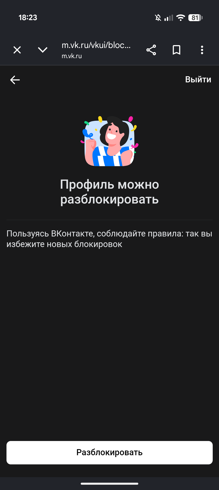

# 📸 VK Album Downloader

### Приложение для автоматического скачивания альбомов фотографий из Вконтакте.

## ⚠️ Важная информация ⚠️
### **Приложение использует ваш [токен авторизации](https://id.vk.ru/about/business/go/docs/ru/vkid/latest/vk-id/connection/tokens/access-token#Kak-poluchit-token) в качестве доступа к API VK. Не передавайте его никому, в целях безопасности.**
### **Если слишком часто получать новые токены авторизации, страница может быть заморожена и придется менять пароль:**

### При скачивании файлов не включайте\выключайте VPN, так как токен VK выдается под конкретный IP.

## 📲 Инструкция по установке
### 1. Скачать и установить версию для вашей ос https://github.com/mlpoffff/vk-album-downloader/releases/latest
### 2. Открыть установленное приложение

## 📄 Как пользоваться
### 1. Нажмите кнопку "Получить ссылку"

### 2. Пройдите авторизацию в ВК

### 3. Скопируйте ссылку на страницу с ошибкой

### 4. Вставьте ссылку в поле ввода

### 5. Можете скачивать альбомы (альбомы сохраняются по пути /загрузки/vk_albums/название_альбома)

## 🪲 Известные баги
* Иногда не работает с очень старыми альбомами/фотографиями

## 🛠️ Инструкция по установке и запуску из исходников
1. Скачать и распаковать архив https://github.com/mlpoffff/vk-album-downloader/archive/refs/heads/main.zip
2. Создать .env в корне проекта из .env.example
3. Команды:
  * `npm install` - установка зависимостей
  * `npm run dev` - запуск дев сервера
  * `npm run dev:electron` - запуск дев сервера с electron-приложением
  * `npm run build` - собирает nuxt 
  * `npm run build:electron` - собирает electron-приложение вместе с nuxt

## ❤️ Отдельное спасибо
* [vkhost](https://github.com/vkhost) за [механизм получения токенов авторизации](https://github.com/vkhost/vkhost.github.io)
* [MasyanyX](https://github.com/iMasyanyX) за [механизм скачивания из ВК](https://github.com/iMasyanyX/VKPhotoDownloader)
