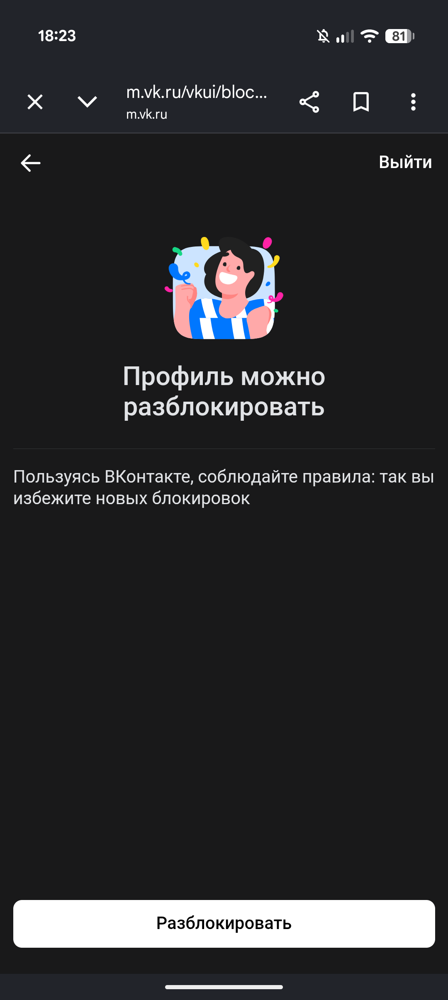

# 📸 VK Album Downloader

### Приложение для скачивания альбомов фотографий из Вконтакте.


## ⚠️ Важная информация ⚠️
### **Приложение использует ваш [токен авторизации](https://id.vk.ru/about/business/go/docs/ru/vkid/latest/vk-id/connection/tokens/access-token#Kak-poluchit-token) в качестве доступа к API VK. Не передавайте его никому, в целях безопасности.**
### **Если слишком часто получать новые токены авторизации, страница может быть заморожена и придется менять пароль:**


### При скачивании файлов не включайте\выключайте VPN, так как токен VK выдается под конкретный IP.


## 📲 Инструкция по установке
### 1. Скачать и установить версию для вашей ос https://github.com/mlpoffff/vk-album-downloader/releases/latest
### - .dmg - MacOS
> После установки приложения на MacOS перед первым запуском один раз выполните:
>
> ```xattr -c /Applications/VKAlbum.app```
### - .exe - Windows
### - Остальное - Linux
### 2. Открыть установленное приложение


## 📄 Как пользоваться
### 1. Нажмите кнопку "Получить ссылку"

### 2. Пройдите авторизацию в ВК

### 3. Скопируйте ссылку на страницу с ошибкой

### 4. Вставьте ссылку в поле ввода

### 5. Можете скачивать альбомы (альбомы сохраняются по пути /загрузки/vk_albums/название_альбома)


## 🛠️ Инструкция по установке и запуску из исходников
1. Скачать и распаковать архив https://github.com/mlpoffff/vk-album-downloader/archive/refs/heads/main.zip
2. Команды:
  * `pnpm install` - установка зависимостей
  * `pnpm tauri:dev` - запуск дев сервера c tauri-приложением
  * `pnpm tauri:build` - собирает tauri-приложение вместе с nuxt
  * `pnpm tauri:build:debug` - собирает tauri-приложение вместе с nuxt в дебаг режиме


## ❤️ Отдельное спасибо
* [vkhost](https://github.com/vkhost) за [механизм получения токенов авторизации](https://github.com/vkhost/vkhost.github.io)
* [MasyanyX](https://github.com/iMasyanyX) за [механизм скачивания из ВК](https://github.com/iMasyanyX/VKPhotoDownloader)
