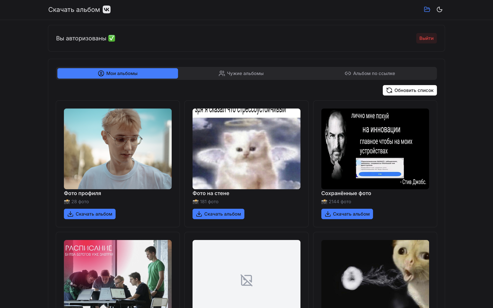

<p align="center">
  
</p>

<h1 align="center">VKAlbum</h1>

<p align="center">
  Десктопное приложение для скачивания фотоальбомов из VK.
</p>

<p align="center">
  <a href="https://github.com/mlpoffff/vk-album-downloader/releases/latest">Скачать последнюю версию</a>
  ·
  <a href="https://github.com/mlpoffff/vk-album-downloader/issues">Сообщить о проблеме</a>
</p>



## Возможности

- скачивание собственных альбомов пользователя;
- скачивание альбомов других пользователей и сообществ;
- загрузка конкретного альбома по ссылке;
- отображение прогресса и возможность отменить загрузку;
- выбор папки для сохранения фотографий;
- системные уведомления и звуковые сообщения о результате;
- светлая и тёмная темы оформления.

## Быстрый старт

1. Откройте страницу [последнего релиза](https://github.com/mlpoffff/vk-album-downloader/releases/latest).
2. Скачайте установщик для своей системы:
   - `.exe` — Windows;
   - `.dmg` — macOS;
   - `.AppImage` или `.deb` — Linux.
3. Установите и запустите VKAlbum.

> [!NOTE]
> Если macOS не разрешает открыть приложение, один раз выполните в терминале:
>
> ```bash
> xattr -c /Applications/VKAlbum.app
> ```

## Как пользоваться

### 1. Авторизуйтесь через VK ID

Для работы с альбомами приложению нужен токен доступа VK. Подробная инструкция с иллюстрациями находится в [docs/auth.md](docs/auth.md).

> [!WARNING]
> [Токен авторизации](https://id.vk.ru/about/business/go/docs/ru/vkid/latest/vk-id/connection/tokens/access-token#Kak-poluchit-token) — конфиденциальные данные. Не публикуйте его и не передавайте другим людям.
> Частое использование такого токена может привести к [заморозке страницы](docs/block.png).
>
> Не переключайте VPN во время загрузки: VK привязывает токен к IP-адресу.

### 2. Выберите папку сохранения

Нажмите кнопку с иконкой папки в правом верхнем углу. Если папка не выбрана, фотографии сохраняются по умолчанию в:

```text
Загрузки/vk_albums/<название-альбома>/
```

### 3. Найдите и скачайте альбом

В приложении доступны три режима:

- **Мои альбомы** — альбомы авторизованного пользователя;
- **Чужие альбомы** — альбомы пользователя или сообщества по ссылке;
- **Альбом по ссылке** — загрузка конкретного альбома VK.

Нажмите **«Скачать альбом»** на нужной карточке. Прогресс загрузки отображается прямо в интерфейсе, а после завершения приложение покажет уведомление.

## Запуск из исходников

### Требования

- [Node.js 24.19.0](https://nodejs.org/);
- [pnpm](https://pnpm.io/);
- [Rust](https://www.rust-lang.org/tools/install) и Cargo;
- системные зависимости [Tauri 2](https://v2.tauri.app/start/prerequisites/).

### Установка и разработка

```bash
git clone https://github.com/mlpoffff/vk-album-downloader.git
cd vk-album-downloader
pnpm install
pnpm tauri:dev
```

Команда `pnpm tauri:dev` запускает Nuxt и десктопное приложение Tauri в режиме разработки.

### Сборка

```bash
# production-сборка приложения
pnpm tauri:build

# debug-сборка
pnpm tauri:build:debug
```

Готовые артефакты появятся в `src-tauri/target/release/bundle/`.

Полезные команды проекта:

```bash
pnpm lint       # проверка ESLint
pnpm typecheck  # проверка TypeScript
pnpm generate   # статическая сборка Nuxt
```

## Технологии

- [Nuxt 4](https://nuxt.com/) и [Vue 3](https://vuejs.org/);
- [Nuxt UI](https://ui.nuxt.com/) и [Pinia](https://pinia.vuejs.org/);
- [Tauri 2](https://v2.tauri.app/) и Rust;
- VK API `5.199`.

## Благодарности

- [vkhost](https://github.com/vkhost) — за механизм получения токена авторизации;
- [MasyanyX](https://github.com/iMasyanyX) — за идею и механизм скачивания фотографий из VK.

---

<p align="center">
  Сделано с ❤️ для удобного сохранения фотографий из VK
</p>
