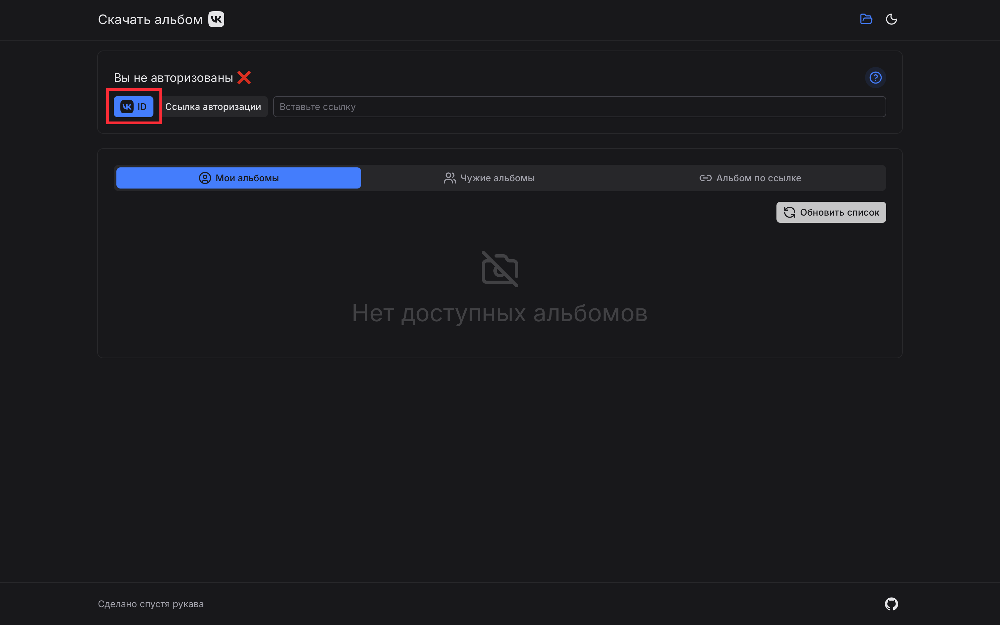
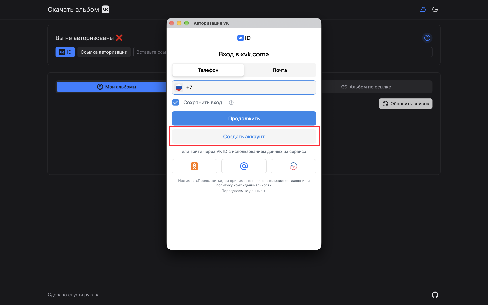
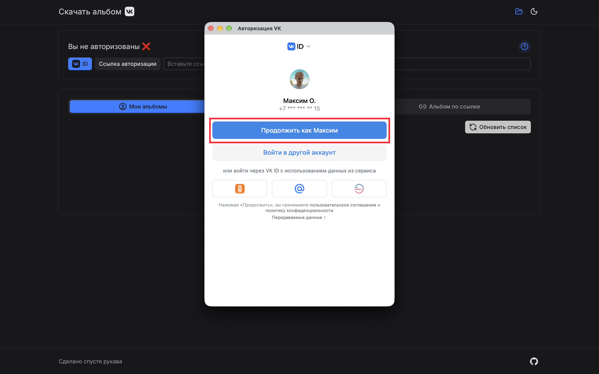
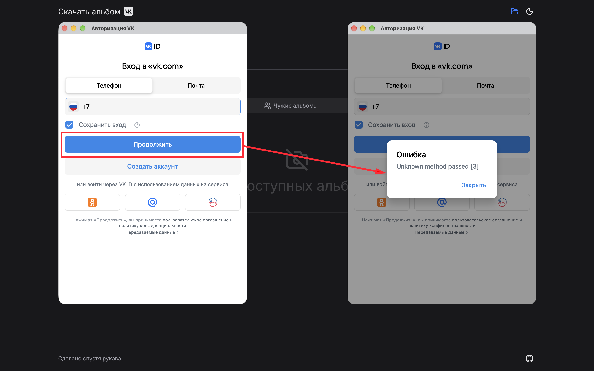
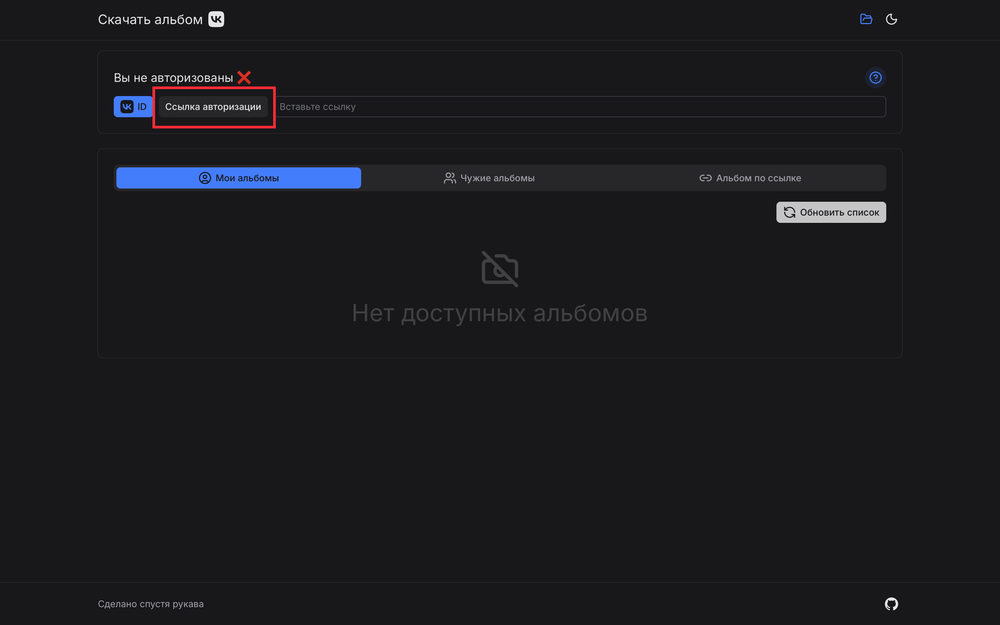
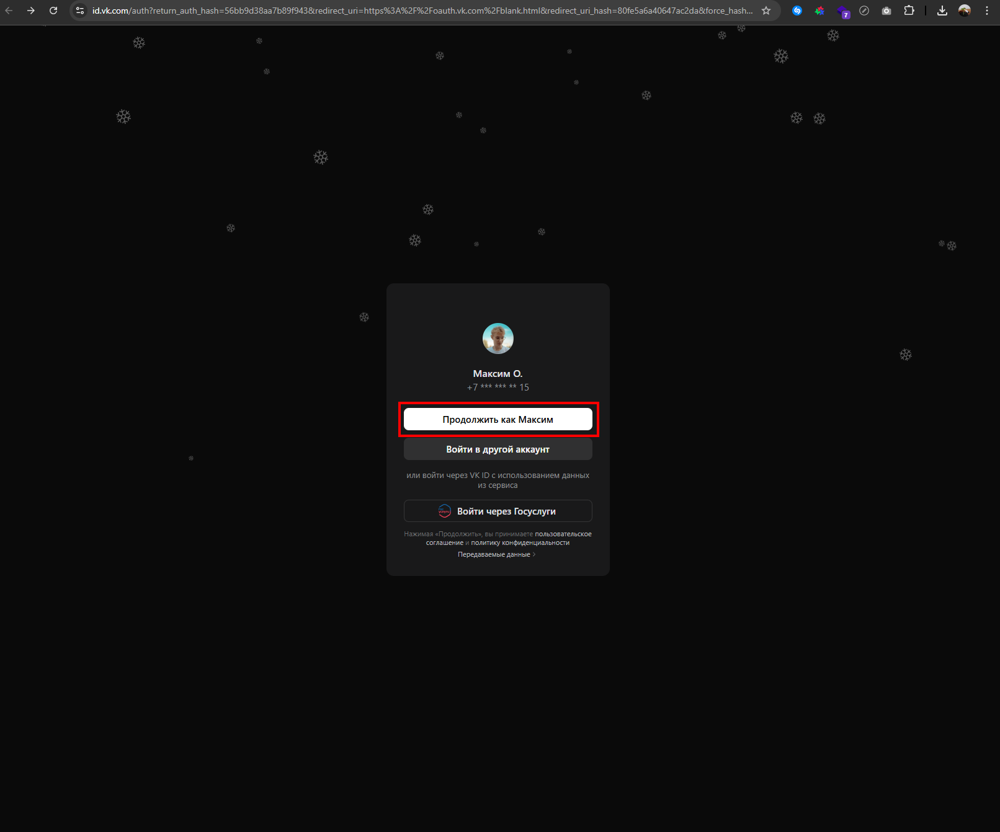
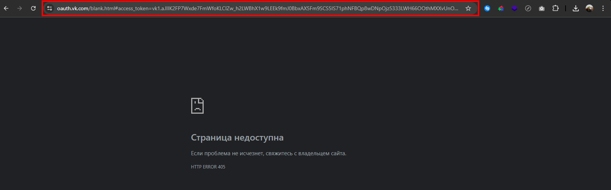
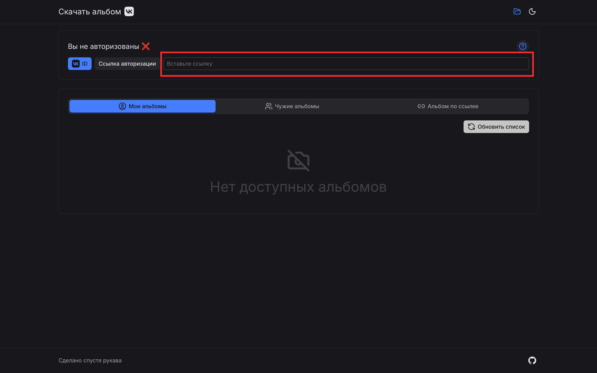

# 🔐 Авторизация в приложении

Для скачивания альбомов необходимо авторизоваться через **VK ID**. Ниже описаны два способа входа: рекомендуемый новый и альтернативный старый.

## Новый способ — без перехода в браузер

1. Нажмите кнопку **«VK ID»**.

   

2. Нажмите **«Создать аккаунт»** и пройдите авторизацию.

   

3. Снова нажмите кнопку **«VK ID»**.

   

4. Войдите в свой аккаунт VK.

   

> **Если появилась ошибка**
>
> При нажатии кнопки **«Продолжить»** вместо **«Создать»** может появиться ошибка. В этом случае воспользуйтесь старым способом авторизации, описанным ниже.
>
> 

## Старый способ — через ссылку

1. Нажмите кнопку **«Получить ссылку»**.

   

2. Пройдите авторизацию во ВКонтакте.

   

3. Скопируйте ссылку на страницу с ошибкой.

   

4. Вставьте скопированную ссылку в поле ввода приложения.

   
